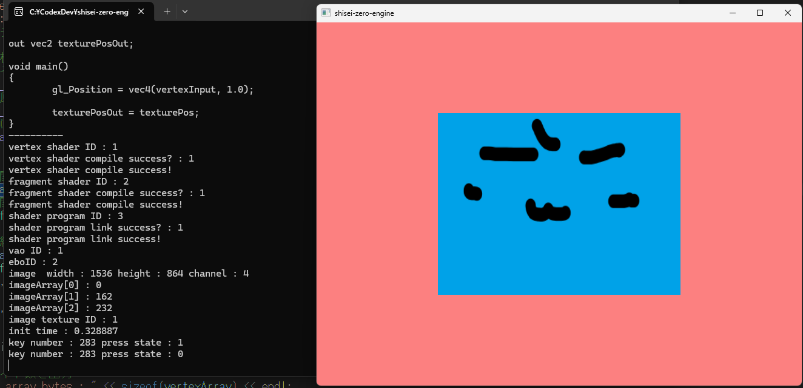

# 試製零号発動機

C++ と OpenGL で「GPUはどうやって絵を出すのか」を理解しながら、Scene A(タイトル)からScene B(プレイ)へ切り替わる収集型ミニゲームを載せる、グラフィックス中心の最小ランタイムゲームエンジンです。

## スクリーンショット / GIF



## 現在地 / ロードマップ

2026年11月12日に進め方を作り直し、「画面に見える変化1つ」ごとに進めています。

- [x] 計画策定・環境準備（公開前の検証と封印を含む。）
- [x] 三角形・シェーダー・テクスチャ — まず絵を出す (2026-10)
- [x] 自作の Vec3・Mat4 とテスト(平行移動・拡大縮小・Z軸まわりの回転・行列の積) (2026-10〜11)
- [x] 自分の行列をシェーダーへ送り、四角を動かす・回す (2026-11)
- [x] 遠近を付ける行列(透視投影)を自作し、四角を3Dの中に置く (2026-11)
- [x] 箱を描き、手前の面が奥の面を隠すようにする(深度テスト) (2026-11)
- [ ] 同じ箱を何個も並べる (次にやること)
- [ ] カメラの行列(lookAt)を自作し、WASDで歩く、マウスで見回す
- [ ] 2026年末の節目: 箱の並ぶ3D空間を歩き回れる exe を、配れる形にまとめる
- [ ] エンジンの形を整える(メッシュ・シェーダー・テクスチャ・場面に置く物の一覧に分ける)
- [ ] 光を当てる(Phongライティング)
- [ ] OBJモデル読み込み(パーサー自作)。彫刻のモデルを映す
- [ ] Scene A(タイトル)→Scene B(プレイ)の収集型ミニゲーム、距離ベース当たり判定、ゲーム状態、画像/アイコン方式のUI
- [ ] 仕上げ: Release配布パッケージ、構成図 (2027-02〜03)

年末より先の範囲は仮で、どこまでやるかは年末に決めます。現在地の正本は [STATUS.md](STATUS.md) です。最終公開前に、スクリーンショット/GIF・Release内容を更新します。

## ビルド・操作方法

Windows / Visual Studio(C++ワークロード。同梱のCMake+Ninjaを使用) / Git が必要です。

```text
ビルド: powershell -ExecutionPolicy Bypass -File scripts\build.ps1 -Path . -Run
操作: ビルドするとウィンドウが表示され、テクスチャ付きの四角が2つ回ります。ウィンドウをドラッグすると大きさを変更できます。Escボタンかウィンドウ右上の×ボタンでエンジンを閉じることができます。
```

または Visual Studio の「フォルダーを開く」でこのフォルダを開いてもビルドできます。
cmake がPATHにある環境なら `cmake -S . -B build && cmake --build build` でも可。
依存ライブラリ(GLFW 3.4)は CMake の FetchContent が自動取得します。
依存ライブラリ（GLAD 2.0.8・stb_image 2.30）は手動で導入します。

## 使用している外部部品とライセンス
- GLFW / 3.4 / zlib/libpng / https://www.glfw.org/license.html / 2026年10月28日
- GLAD / 2.0.8 / (WTFPL OR CC0-1.0) AND Apache-2.0 / ヘッダー内記載 / 2026年10月28日
- stb_image / 2.30 / MIT License OR Public Domain / ヘッダー内記載 / 2026年10月28日

## 使用素材
- assets内の画像は自分で描いた

## このプロジェクトの約束事(AI使用ポリシー)

生成AIは「家庭教師」として使い、「代筆者」としては使いません。

- `src/` のコードはすべて自分の手で打ち込んでいる。AIはファイルを編集しない
- OpenGL や GLFW の呼び出しの作法は、AIが教材として示した見本を見ながら打っている
- 3D数学、OBJの読み込み、エンジンの組み立て方は、式と関数の形だけを教わり、中身は自分で書いている(詰まって関数1つ分を見せてもらったときは、下の台帳に記録している)
- 作業台（ビルド設定・依存取得・梱包・検証の配管）はAI提供可。ゲームロジックや `src/` へ取り込むコードは作業台に含めない
- AIの関与は [docs/disclosure-log.md](docs/disclosure-log.md) のコミット単位台帳に、対象ファイルと箇所が分かる粒度で記録する
- 運用ルールの全文は [AGENTS.md](AGENTS.md)

2026年11月11日までは、AIからは概念・手順・APIの名前を教わり、コードは詰まったときだけ関数単位で見せてもらう決まりで進めていました(見せてもらった箇所は上の台帳に記録しています)。11月12日から上の形に変えました。

コミット履歴そのものが学習の記録です。

## 構成(目標の形)

完成時に目指している形です。今あるのは、メインループと、自作の Vec3・Mat4 までです。

```text
Main Loop
  ├─ Input / Time → Camera / Transform
  ├─ Scene（少数オブジェクトの配列）
  ├─ Asset（shader / texture / OBJ）
  ├─ Mesh / Material
  └─ Renderer（固定順の描画パス）
```

まとめていく順番:

- `poll input → update → render → present` の1本のフレーム経路を作る(済)
- 自作Vec3/Mat4を零号機全体の座標の共通言語にする(進行中)
- 入力 → カメラ → 場面に置く物の配列 → 1つの描画入口、に統合する
- 手で書いた箱と、OBJから読んだモデルを、同じ描画入口へ通す
- Scene A(タイトル)からScene B(プレイ)へ切り替え、距離ベース当たり判定とゲーム状態を使う収集型ミニゲームとしてRelease版にまとめる

2027年以降は零号機をゲーム制作基盤へ拡張する構想です。壱号機・弐号機は将来構想として名前だけを置いており、今回の計画では機能範囲や対応時期を確定しません。[ROADMAP.md](ROADMAP.md) を参照してください。

## 既知の限界と次にやること

(仕上げのときに記入する。現状の限界を自覚として明記する節 — 例: ガンマ補正/リニアワークフロー未対応、視錐台カリング等の描画最適化は未実装(全オブジェクトを毎フレーム描画)、背面カリング未使用)
